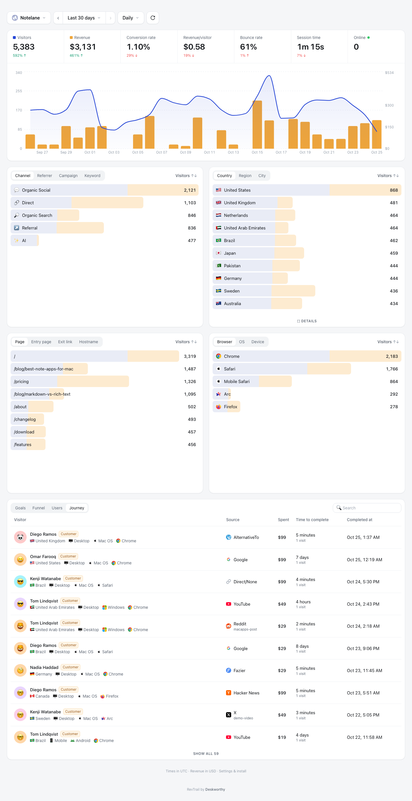

# RevTrail

**Open-source, cookieless revenue analytics. See which tweet, article, search or AI answer actually made you money.**

RevTrail is a self-hosted DataFast alternative for indie hackers and small SaaS teams. It tracks visitors like Plausible or
Umami, then links every payment from **Polar** or **Dodo Payments** to the visit that brought the buyer, so your dashboard shows
revenue by source, not just traffic. It sets no cookies, needs no consent banner, and runs free on your own Cloudflare account.



## Why RevTrail

| | RevTrail | DataFast | Plausible | Umami | Google Analytics |
| --- | --- | --- | --- | --- | --- |
| Revenue by traffic source | Yes | Yes | Revenue goals (custom events) | Revenue report (custom events) | Ecommerce setup |
| Polar integration | Built in | Yes | No (send events yourself) | No (send events yourself) | No |
| Dodo Payments integration | Built in | Yes | No (send events yourself) | No (send events yourself) | No |
| Cookies / consent banner | None | Cookies | None | None | Cookies, banner |
| Open source | MIT | No | AGPL | MIT | No |
| Hosting cost | Free (Cloudflare free plan) | Paid | Paid, or your server | Paid, or your server | Free |
| Your data stays on your account | Yes | No | Self-hosted only | Self-hosted only | No |

## What you get

- **Revenue first:** visitors, revenue, conversion rate, revenue per visitor, bounce rate, session time and who is online now,
  each compared with the previous period.
- **Where buyers come from:** channel, referrer (X, Google, ChatGPT, Perplexity, Reddit, Hacker News...), campaign and keyword
  from `utm_*` tags, and short `?ref=` tags.
- **Who paid:** a Journey list of every customer with their source, amount and time to convert, plus each visitor's full
  timeline: visit, pages, clicks, payment.
- **Location and tech:** country, region, city, browser, OS and device.
- **Behaviour:** pages, entry pages, outbound clicks, button clicks and custom goals, and funnels.
- **Filters everywhere:** click any row to filter the whole dashboard, for example "only visitors from the launch tweet".
- **Several websites, one login.**
- **AI install prompt:** each site's settings page has a prompt you paste into Claude Code or Cursor to install tracking and
  checkout attribution in your codebase.

## Privacy: no cookies, no banner

RevTrail stores nothing in your visitors' browsers. The server recognises a visitor by a keyed hash of the site, their IP
address and their browser's user agent. The key is random and changes every calendar month; old keys are deleted, so last
month's visitor ids can no longer be linked to anyone, and the IP address itself is never stored. A visit ends after 30
minutes without activity.

The tracking script keeps the visitor id in memory only, to tag checkout links on the page. Personal data in URLs, such as
`?email=` on a thank-you page, is stripped in the browser before anything is sent.

What this means in practice: a buyer who clicked your tweet and paid within the same month is credited to the tweet; one who
comes back after the month turns is counted as a new visitor. Payments are still recorded either way.

## Deploy for free (about 10 minutes)

You need a free [Cloudflare account](https://dash.cloudflare.com/sign-up), [Node.js 20+](https://nodejs.org) and Git.

```bash
git clone https://github.com/ahmedmukhtar1133/revtrail.git
cd revtrail
npm install
npx wrangler login
npx wrangler d1 create revtrail          # copy the printed database_id into wrangler.jsonc
npx wrangler secret put ADMIN_PASSWORD   # the dashboard password
npx wrangler secret put SESSION_SECRET   # any long random text: openssl rand -hex 32
npm run deploy
```

`npm run deploy` builds the dashboard, creates the database tables and deploys. Open the printed URL, log in, add your website
and copy its script tag. To use your own domain, such as `analytics.example.com`, add it in Cloudflare under Workers & Pages,
revtrail, Settings, Domains & Routes.

**Updating later:** `git pull && npm run deploy` (keep your `database_id` edit in `wrangler.jsonc`).

### What the Cloudflare free plan covers

| Free limit | What it means here |
| --- | --- |
| 100,000 Worker requests a day | About 100k tracked events a day across all sites |
| 100,000 D1 rows written a day | About 10k pageviews a day |
| 5 million D1 rows read a day | Hundreds of dashboard loads a day at 10k visitors a month |
| 5 GB D1 storage | Years of data at side-project traffic |

If you outgrow it, Cloudflare's Workers Paid plan is $5 a month.

## Install the script

```html
<script defer data-website-id="SITE_ID" src="https://YOUR-REVTRAIL-HOST/js/script.js"></script>
```

- **Goals:** `<button data-rt-goal="signup_click">`, or `window.revtrail('goal', 'signup', { plan: 'pro' })`
- **Identify signed-in users:** `window.revtrail('identify', { user_id, email, name })`
- **Ignore your own visits:** open `https://yoursite.com/?rt_ignore=true` once in each browser you use
- **Single-page apps** (Next.js, React Router, Astro view transitions) are tracked automatically
- **Ad blockers:** serve the script and the `/api/event` endpoint from your own domain (a Cloudflare route or a framework
  rewrite) and point `data-api` at it. Settings shows how.

## Revenue attribution with Polar

1. In Polar, Settings, Webhooks, add `https://YOUR-HOST/api/webhooks/polar/SITE_ID` (format Raw) and subscribe to `order.paid`
   and `order.refunded`. Paste the webhook secret into the site's settings in RevTrail.
2. That's it for checkout links on your pages: the script adds the visitor to every Polar checkout link as `reference_id`,
   which Polar keeps on the checkout. For checkouts you create in code, send `window.revtrail.attribution().rt_visitor_id`
   to your server and set it as `metadata.reference_id`.
3. Recommended: set the checkout's success URL to a page on your site with the checkout id, such as
   `https://yoursite.com/thanks?checkout_id={CHECKOUT_ID}`. A visit to it links the order to the exact visitor even when the
   reference is lost.

Revenue is the order's net amount: Polar is the merchant of record and pays the tax, so tax is not your revenue. Refunds are
subtracted, and subscription renewals are recognised.

## Revenue attribution with Dodo Payments

1. In Dodo, Developer, Webhooks, add `https://YOUR-HOST/api/webhooks/dodo/SITE_ID` and subscribe to `payment.succeeded` and
   `refund.succeeded`. Paste the signing secret into the site's settings.
2. Dodo payment links on your pages are tagged automatically. For checkout sessions created in code, send
   `window.revtrail.attribution().rt_visitor_id` to your server and add it to the session's metadata as `rt_visitor_id`.
3. Recommended: set the return URL to a page on your site; Dodo adds `?payment_id=` to it, which links the payment to the
   visitor even without metadata.

## Any other payment provider

Send payments from your backend with the site's API key:

```bash
curl -X POST https://YOUR-HOST/api/v1/payments -H "Authorization: Bearer rt_..." -H "Content-Type: application/json" \
  -d '{"transaction_id":"txn_1","amount":29.99,"currency":"USD","visitor_id":"<window.revtrail.attribution().rt_visitor_id>","email":"jane@acme.com"}'
```

## How a payment finds its visitor

A payment is credited to the buyer's last visit that came from a real source (last non-direct touch), so "clicked a tweet,
came back directly a week later and paid" is credited to the tweet. RevTrail tries, in order:

1. The visitor id carried by the checkout (`reference_id` for Polar, metadata for Dodo and the API)
2. A visit to your return page with that payment's id
3. An earlier payment by the same customer (renewals)
4. An email you passed to `identify()`
5. Timing: used only when exactly one visitor clicked a checkout link in the 3 hours before the payment

The Journey tab shows how each payment was matched, and **Try matching again** re-runs this for older payments.

## Tracking a specific post or listing

Most platforms hide which exact post sent a visitor; X shows only `t.co`, and apps such as Slack, Discord and email clients
often send no referrer at all. Tag the links you share, one tag per platform or per post:

```
https://yoursite.com/?ref=launch-tweet
https://yoursite.com/?utm_source=x&utm_medium=social&utm_campaign=launch
```

Settings has a link builder for this. For SEO, Google never shares the search keyword, but the **Entry page** for the
**Google** referrer tells you which article people found.

## Accuracy notes

- **Ad blockers** block some analytics domains. Serve RevTrail from your own domain. Payments are always recorded by the
  webhook, even when a buyer's browser blocked tracking.
- **Shared networks:** visitors behind the same IP address with the same browser version count as one visitor.
- **Bots** are filtered by user agent and the `navigator.webdriver` flag.
- **Currencies:** amounts are reported in the currency each payment was made in; Dodo settlement amounts are used when they
  match your site's currency.

## Local development

```bash
npm install
npx wrangler d1 migrations apply revtrail --local
npx wrangler dev --port 8787 --var ADMIN_PASSWORD:change-me --var SESSION_SECRET:dev   # API on :8787
npx vite                                                                               # dashboard on :5173
npm test                 # unit tests
node scripts/smoke.mjs   # end-to-end test against the running dev server
```

## Tech

Cloudflare Workers, D1 (SQLite), Hono, React, Vite, Tailwind and Recharts. The tracker is a single dependency-free script of
about 3 KB gzipped.

## Built by Deskworthy

RevTrail is built and maintained by [Deskworthy](https://deskworthy.app?ref=github&utm_campaign=revtrail), a small studio making fast, focused
desktop apps for the Mac. We run RevTrail on our own site to see which posts and listings actually sell our apps. If it helps
you too, have a look at what we make.

## License

[MIT](LICENSE)
